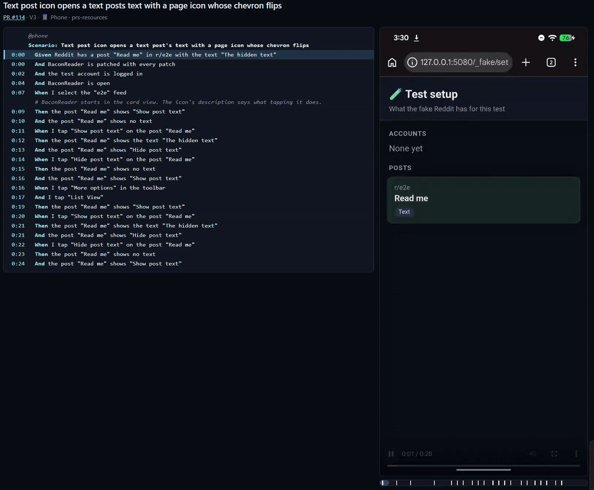
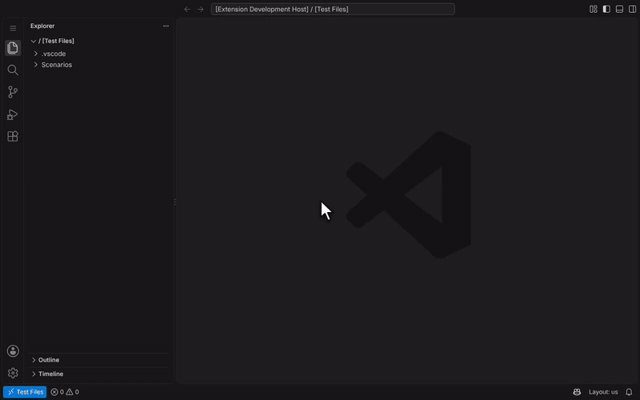

# Living Proof

This is how I verify my apps nowadays:

1. I ask AI with an unstructured prompt
2. AI asks me clarifying questions
3. AI presents a Gherkin
4. I criticise until I approve it
5. AI implements it, writes the tests, runs them and records them

Then I review the work by **watching a video** of the feature working, together with its Gherkin.

---

## Why I needed this

For a long time (in AI time, at least) I worked with planning skills: Superpowers first, then Matt Pocock's. When
models weren't as good, they were a must. As the models got better, my confidence grew, and the process started to
feel heavier than the work itself. Understanding a plan and reviewing every line of code it planned took real mental
effort, and I still couldn't see anything working. Colleagues suggested skipping the plan and reviewing the PR
instead. Given my own experience with AI, I wasn't ready for that yet.

There was another catch: the plans weren't checked against the current code, so during implementation the agent
often had to correct them. I tried telling the agent to verify the plan against the code. It worked, and the
implementation was flawless, but to verify the plan the agent had to write a first version of the code. Throwaway or
not, the code had to be written before the plan could be trusted.

My conclusion was: if it has to be partially or fully implemented anyway, then just implement it. So I started
skipping the plans and reviewing the PRs, as my colleagues suggested. And I stopped using the skills so dogmatically.

At this point I still had to read the tests and picture the whole process in my mind. And I still had to run the app
myself to make sure it started and worked as expected.

Then I started playing with Android patching frameworks. AI was decompiling an APK and exploring it to make sense of
it, to then write code I could not even comprehend, in an app I didn't have the source code for. And I still had to
test it manually, to make sure there weren't any runtime errors and that the patch did what I defined.

So the obvious question arose: how can I actually be sure that an app does what I defined?

Unit tests prove the pieces, not the app. They won't tell you if the app starts, if it does what it should, or if
there are bugs in the seams. I can have 2,000 unit tests and the app may still not start.

In the end, what I actually want to know is simple: does the real app behave exactly as I defined?

There's only one way to know: watch it work.

[](media/head-demo.mp4)

Here is how it's built, one block at a time.

---

## Block 1: Say exactly what the app should do

When I prompt for a task, the AI shows me how it will prove the feature works, as Gherkin: Given, When, Then.

I have a whole file on how to write a Gherkin. I use precise language: on this screen, tap this button, this text
shows. And the texts are copied from the UIs, never from the code. This way anyone could pick up the Gherkin and play it on the
phone with nothing left to guess.

Here's the Gherkin of the video above:

```gherkin
Scenario: Text post icon opens a text post's text with a page icon whose chevron flips
  Given Reddit has a post "Read me" in r/e2e with the text "The hidden text"
  And BaconReader is patched with every patch
  And the test account is logged in
  And BaconReader is open
  When I select the "e2e" feed
  # BaconReader starts in the card view. The icon's description says what tapping it does.
  Then the post "Read me" shows "Show post text"
  And the post "Read me" shows no text
  When I tap "Show post text" on the post "Read me"
  Then the post "Read me" shows the text "The hidden text"
  And the post "Read me" shows "Hide post text"
  When I tap "Hide post text" on the post "Read me"
  Then the post "Read me" shows no text
  And the post "Read me" shows "Show post text"
  When I tap "More options" in the toolbar
  And I tap "List View"
  Then the post "Read me" shows "Show post text"
  When I tap "Show post text" on the post "Read me"
  Then the post "Read me" shows the text "The hidden text"
  And the post "Read me" shows "Hide post text"
  When I tap "Hide post text" on the post "Read me"
  Then the post "Read me" shows no text
  And the post "Read me" shows "Show post text"
```

## Block 2: A place where the app can really run

This is where I invested the most.

For a web page, I open a browser with Playwright and click around.

For a patched APK, I have a real phone plugged into my NAS at home. Only a Docker container on the NAS can reach it,
and only through my private network.

For both, I use simulators for the third-party services the app depends on, like Reddit, so every test starts from
the same state. The simulators are configurable and have their own screens, so when a test sets one up, the setup
plays in the video too: even the Given is something you can watch.

It took a lot of work to make it secure, reliable and fast. That work is what everything else stands on.

## Block 3: One Gherkin, one test, no translation layer

Each Gherkin becomes exactly one end-to-end test in C#. It holds the Gherkin word for word and does what each line
says, in order:

```csharp
[Theory, PlayOnPhone]
[PatchedWithEveryPatch]
[TestDescription("""
    @phone
    Scenario: Text post icon opens a text post's text with a page icon whose chevron flips
      Given Reddit has a post "Read me" in r/e2e with the text "The hidden text"
      And BaconReader is patched with every patch
      And the test account is logged in
      And BaconReader is open
      When I select the "e2e" feed
      # BaconReader starts in the card view. The icon's description says what tapping it does.
      Then the post "Read me" shows "Show post text"
      And the post "Read me" shows no text
      When I tap "Show post text" on the post "Read me"
      Then the post "Read me" shows the text "The hidden text"
      And the post "Read me" shows "Hide post text"
      …
    """)]
public async Task TextPostIconOpensATextPostsTextWithAPageIconWhoseChevronFlips(Screen screen)
{
    // Given
    Reddit.HasAPostWithTheText("Read me", "e2e", "The hidden text");
    Reddit.TheTestAccountIsLoggedIn();
    await Phone.BaconReader.OpenAsync();

    // When
    await Phone.BaconReader.Main.Toolbar.SelectFeedAsync(new Feed.Subreddit("e2e"));
    await Phone.BaconReader.Main.Toolbar.WaitUntilFeedShownAsync(new Feed.Subreddit("e2e"));
    await Phone.BaconReader.Main.Posts.WaitUntilOnlyPostsShownAsync("Read me");

    // Then
    // BaconReader starts in the card view. The icon's description says what tapping it does.
    var cardClosed = await Phone.BaconReader.Main.Posts.ReadPostAsync("Read me");
    Asserting.That(cardClosed)
        .ShowsNoText()
        .ShowsTheTextButton(new TextPostButton.ShowPostText());

    // When
    await Phone.BaconReader.Main.Posts.ClickTextButtonAsync("Read me", new TextPostButton.ShowPostText());
    await Phone.BaconReader.Main.Posts.WaitUntilPostTextShownAsync("Read me");

    // Then
    var cardOpen = await Phone.BaconReader.Main.Posts.ReadPostAsync("Read me");
    Asserting.That(cardOpen)
        .ShowsTheText("The hidden text")
        .ShowsTheTextButton(new TextPostButton.HidePostText());

    // … and the same for hiding it, then again in the list view.
}
```

The full test: [TextPostIconTests.cs](https://github.com/JoanComasFdz/baconreader-reseam-patches/blob/main/tests/BaconReader.E2E/Scenarios/LoggedIn/Posts/TextPostIcon/TextPostIconTests.cs).

You might say: "That's what SpecFlow is for." It isn't, for me. SpecFlow needs a layer in between: small, disconnected
functions that match your sentences. And everyone writes their sentences their own way. "When the simulator is
loaded", "when the simulator is ready", "when the simulator is configured"... and instead of agreeing on one language,
you end up with a pile of regexes for the same step.

With an LLM, that layer is gone. I have three plain Markdown files:

1. how to write a Gherkin,
2. how to write an end-to-end test,
3. how to turn one into the other, line by line.

That's it.

## Block 4: Let it run until it's green

I always read the Gherkin. The question is when.

The first time I do something new, I read it before anything gets built, and I fix what's wrong. The second time, I
skim it, and usually it's fine. By the third or fourth time, the rules have proven themselves, so I just say "go
ahead" and read the Gherkin afterwards, with the video next to it. Watching the app do it is more engaging than
picturing it from text, and it tells me more.

That's judgement, not a rule. It works because my instructions tell the AI what happens after the Gherkin:

1. AI writes the end-to-end test from the Gherkin.
2. AI runs it, and fixes what fails until it passes.

## Block 5: Recorded and posted on the PR

When the test is green, AI records it. Then it opens a pull request and posts the recordings on it: a GIF to watch
right there in the comment, and an MP4.

The PR of the scenario above: [BaconReader patches #114](https://github.com/JoanComasFdz/baconreader-reseam-patches/pull/114).

It might take two hours. I don't care. When it's done, I open the PR and there's the Gherkin and the app doing it.

## Block 6: The video and the Gherkin, in sync

A GIF wasn't enough. While it records, the test also notes the moment each line of the Gherkin starts. A small player
puts the Gherkin on the left and the video on the right. Press play and the line being played lights up. Click a line
and the video jumps there.

You don't watch a video. You follow a script, line by line, and see each one happen.

**[▶ Play the scenario above in the player](https://joancomasfdz.github.io/baconreader-reseam-patches/e2e-player.html?v=pr-114-v3-text-post-icon-opens-a-text-posts-text-with-a-page-icon-whose-chevron-flips-phone.mp4#s=7VOxbtswEP2Vg7oSrEhZluUp7dIWaJfEaAc7AyteLAIOKYiM3aDov_coSkgCx0EMdOiQyffI43v3ns6_s222zC661lnc2KsGreqNW8IKfwXonA9gGmfBdWg9KAjT8eYuz2Xl08HBhJYuO7XF1H5onUdoWtz3hG52pvMbC_DJ7NHCJWptArQqEg4SA5m8RKXhFhMAY6F_jxITeWgxSaXbFcHWaE1s8TQdRoUPVsNHRSNEMuzBeJoq0CA68eAe-_t0NLUnappCNY27syG-2bntlp4Ye4IzxhGvfrQ0wRfwuMMmDExpFJp7tHGDqGPnuycUPqg--OgxvmlUr2Fv8MAhGosJTvFq9E1vumAoRq_uPSWrSEh1nbFboBS1Q8-jwCqOEtlOJupbd_DjzRXVqfM4v1eQWJfePURAI71ADe7l2c4xcM4qvDqPz0bjc3kcuXuu8V-6e5TsWQZOfdAjA99cj7S_caP8w19tCNW53U_VT9KPH301RPydNvR8Q2eO97Y9_8v2ZCy7zZbrdcFyXsxYfs3WMpblUM6Y5HI-lCWbcZHKOat4sRjKBat5JYeyZiLnZapFzoTgxQgEE5KXiVxIJopJSRRMEOsIZkyUvEgSomRiPunRD4F6BBUTFa-SvFgwUfNRpmYyTwZyJgXPU78UESxGIJmUfD6CgsmCL-oEyOqMzyO4_vMX)**

## Block 7: One video per feature

Most people write many short tests, each checking one small thing. I went the other way: one feature, one scenario
that plays the whole of it.

Take "embed images in comments", with a setting to turn it on or off. Off, you see a link. On, the image loads. That's
one feature, so it's one video that shows both. Some of mine run seven minutes.

Why? Because that's what a training looks like. If someone sat next to you to show you a feature, they wouldn't
cut it into twelve clips.

## Block 8: The user guide builds itself

So now I had a Gherkin, a recording and a short page for every feature. That's a user guide.

After every merge, the pipeline puts them together into one page: each feature, what it does, and its newest
recording playing next to its Gherkin. Nobody writes it, and it can't go stale, because it is the tests.

When a user asks how something works, I send them the guide: "this is how it works."

The guide for the BaconReader patches: [joancomasfdz.github.io/baconreader-reseam-patches](https://joancomasfdz.github.io/baconreader-reseam-patches).

## Block 9: Installing and updating, recorded too

Furthermore, how to install the app and how to update it are scenarios too, recorded like any other. So the guide
starts with how to get the app, and the person reading it watches each step instead of following screenshots that
may be out of date.

## Block 10: The video next to the code

The recordings were in the PRs and in the guide, but not where I read the tests. So I built a VS Code extension: it
puts a button on top of each end-to-end test, and clicking it opens the player next to the code, with the Gherkin and
its newest video.

That wasn't enough for me either. The extension got its own end-to-end tests, recorded like the app's, so I can see
the extension working too.

[](media/vscode-extension-demo.mp4)

**[▶ Explore it with its Gherkin in the player](https://joancomasfdz.github.io/baconreader-reseam-patches/e2e-player.html?v=pr-103-v3-play-phone-recording-opens-the-phone-video-beside-the-code-desktop.mp4#s=vVNfT9swEP8qp_CKE9pVQ6s0bYVJCAlpVVvBw7oHN742Hokv8jllbNp3x3bc0hV4m_aU5Oz7_bvL72yTjbPPCvneUbs08xKNtJrGMK3lI7QVGQSLJVmlzQaoRcPgKkwnW62QYIXsn7FcksKlATiBLz0kkKkfx_EMfzrfrcmA7TyKNnA7h0vf4O-AhKQhD-1XeosmNlmsUTJCRbXiVElqGGgNy-7sbDict0Try1qjcQtkx3nJ_QGsLTUwncHJu_fx7sU53A5AGhWLo8FzMfBOfD0hpiC4mDtpXdcWk7KkzrjigKt4m1dzDCuA3lXeyzU42Sbs16LdtRnQjmMqNz6s0L6oUhStNFgniNl-JEn_hSzJzFAqtFPpygrVnXbVgb4b2vC1WdAMldJuwv7ZX0_MXNEDvzbKkEnQ5LSrMfjqGw4IvbLICA-eEiInlJEUas8aTDmCnhgkwxH1M4mPQyp-Y6Y7p0fz2JVfjPMI2xuQKwZpcTeFMID-9fRlCdgvXulQHahr_dx26lorRgOxHYhVyEHY6EekIEQIQnAwIPogRAhCaCMc-bshCCE5vO07A3XetKOdophlkO3hnaWa_97Pr365QrA4xKjLT2HZDQcfzpP8DSGH1PvPyrmWx0Xxg6QpqZG8Vr_yjWfoVrmmInpIQiwyyiY54cLjix4_r1xTf9p-_D_OwwZeVWjvvcf9b_7vdi47zZps_O37nyc)**

Basically, I applied this whole workflow everywhere.

## How I develop apps now

I describe what I want. I answer any questions the AI has. I move on to something else until the work is finished.

Then I watch the video and read the Gherkin, and I say one of three things:

- "That's not how I want this Gherkin written."
- "That's not how I expected this to work."
- "Excellent job, merge."

I'm not manually testing the app anymore. The tests do. I don't read a plan, understand it and criticize it
beforehand. If the code isn't what I wanted, I'll see it in the app.

## "But what about performance? Security?"

Fair questions. They're not arguments against this; they're the next blocks. For performance I'd do the same thing:
an environment that measures it, runs every night, gathers the evidence and shows me what got better or worse. I'd
look at the results, not the code.

And to be clear: this is how I build my own apps. At work, I still read the code.

---

Living Proof is how I build:

- the BaconReader patches for [Reseam](https://github.com/JoanComasFdz/baconreader-reseam-patches),
- the BaconReader patches for [Morphe](https://github.com/JoanComasFdz/baconreader-morphe-patches),
- [Loopsmith](https://github.com/JoanComasFdz/destiny-loopsmith).

---

*How this article was written: I explained all of this to a friend in a WhatsApp voice note. AI transcribed it and
split it into the blocks of a first draft. I reworded everything myself, then had AI proofread it.*

---

Licensed under [CC BY 4.0](LICENSE).
